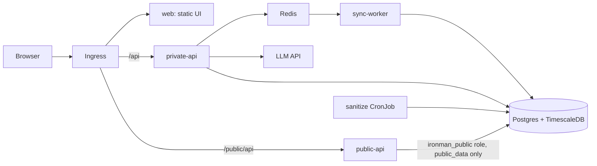

# Ironman training intelligence platform

Tracks triathlon training toward an Ironman: ingests Strava and FIT/GPX
workouts, computes load and fitness metrics (CTL/ATL/TSB), produces baseline
predictions and guarded AI weekly plans, and publishes an anonymised public
dashboard. Everything runs locally on Kubernetes (kind).

> Training signals only, not medical advice.

## Architecture



Privacy by design: the public API connects as a database role that can read
only the `public_data` schema. The sanitize CronJob rebuilds those tables from
an explicit column allowlist (day-level dates, rounded values, pseudonymous
IDs, no GPS, no identity). CI-level tests in `tests/test_privacy.py` fail if
that changes.

## Run locally

Requires docker, kind, kubectl, helm (and uv for tests).

```sh
# add Strava / LLM credentials to .env (optional for a first run)
cp .env.example .env
# create kind cluster "ironman", build images, install the chart
make up
```

Open <http://localhost:8080>: choose "First-time setup" with a password of 12+
characters, add the TOTP URI to an authenticator app, then log in.

```sh
make seed                  # synthetic demo workouts + publish sanitized data
open http://localhost:8080/public.html?demo=1   # public demo (synthetic, no database)
make down                  # delete the cluster
```

### Connecting Strava

1. Create an API application at <https://www.strava.com/settings/api>. Set the
   *Authorization Callback Domain* to `localhost`.
2. Put `IRONMAN_STRAVA_CLIENT_ID` and `IRONMAN_STRAVA_CLIENT_SECRET` in
   `.env`, delete the
   secret so it is regenerated (`kubectl --context kind-ironman delete secret ironman-secrets`),
   and run `make up` again. Existing data lives in persistent volumes.
3. In the app, press **Connect Strava**, then **Sync now**. A CronJob re-syncs
   every 30 minutes.

Strava webhooks need a public URL; locally, rely on the periodic sync, or
expose the cluster with a tunnel and register a subscription pointing to
`/api/strava/webhook`.

## Tests

```sh
make testdb && make test   # needs a TimescaleDB container on :55432
```
