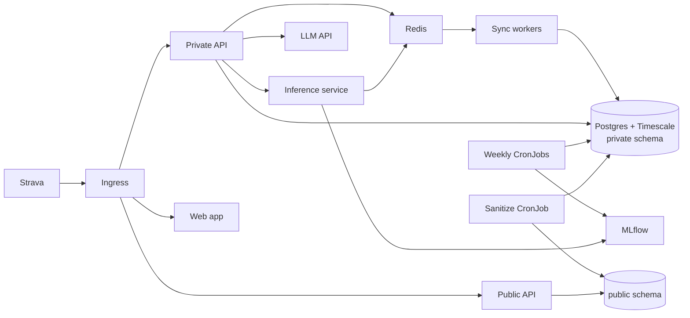

## Context

Greenfield repository, single owner, no existing code or specs. Scope and motivation are in `proposal.md`; requirements are in `specs/`. The binding constraints are the resource budget (4 vCPU, 8 GB RAM, one VM), the requirement that everything runs on Kubernetes (k3s), and that the owner's private health data must never be reachable from the public side.

## Goals / Non-Goals

**Goals:**

- Privacy enforced by the database and network, not by application code alone.
- Whole stack reproducible from Git (Terraform, Helm, ArgoCD).
- Runs on a 16 GB laptop (k3d) and a single small VM.

**Non-Goals:**

- Multi-athlete or multi-tenant support; public percentiles are against open-dataset populations, not platform users.
- High availability, multi-node clusters, or horizontal autoscaling.
- Self-hosted LLMs, real-time (sub-minute) metrics, or native mobile apps.

## Decisions

**Python 3.12 + FastAPI for all services, in one package (`src/ironman/`) built into one image that each Deployment runs with a different command; a static HTML/JS web app served by nginx.** One language and one image avoid duplicate data-handling code and extra build steps for a single-athlete system. Alternatives: separate images per service (clearer boundaries, more build and load time locally), a React/Vite SPA (a build chain the dashboard does not yet need).

**One PostgreSQL instance, separate schemas and roles for private and public data.** `private` holds identity, workouts and features; `public` holds sanitized tables. The public API connects as a role with `SELECT` on `public` only, so a bug in the public API cannot read private rows. Alternative: two databases, which gives stronger isolation but doubles memory on an 8 GB node. Schema plus role plus NetworkPolicy gives the required guarantee at lower cost.

**TimescaleDB for per-sample workout streams and daily metrics.** Hypertables and compression keep 40-80 GB sufficient. Alternative: plain Postgres partitioning; more manual upkeep.

**Redis for queue (RQ or Arq), cache, rate limits and online features.** Lightweight and sufficient for single-athlete volume. Alternative: Celery with RabbitMQ; extra component with no benefit at this scale. Redis uses AOF persistence so queued jobs survive restart.

**Idempotency key = (athlete, start time rounded to the minute, duration bucket) plus source ID.** Allows Strava and FIT copies of one workout to merge. Source ID alone cannot de-duplicate across sources.

**Training stress via TSS-style formulas (power/pace/HR) with CTL (42-day) and ATL (7-day) exponentially weighted averages.** Industry-standard and explainable. Recompute from the earliest changed date on late-arriving workouts.

**Anonymization as a scheduled CronJob that rebuilds public tables from private data (allowlist transform).** Each public column is explicitly mapped; unmapped fields are dropped. GPS: no maps in the first release, so no coordinates are published; a fuzzed-route option is a later toggle. Timestamps reduced to date, ages to brackets, HR optional. A full rebuild (rather than incremental copy) makes deletions propagate and keeps the transform simple. Alternative: database views over private tables; rejected because the public role would then need access to private data.

**Pseudonymous IDs via keyed HMAC of the internal ID, key held in the secrets manager and never in the database.** Prevents join-back from public data.

**ML: LightGBM/XGBoost for race-time and risk, Isolation Forest for anomalies, simple exponential-model forecast for CTL.** Tabular, small data, fast CPU training. Pretrain on GoldenCheetah/FitRec/race-results features where schema-compatible, then fine-tune (continue boosting / refit calibration) on owner data. MLflow tracks runs and the registry; promotion requires non-regression on a held-out time split. Alternative: deep sequence models; unjustified for the data volume and CPU-only budget.

**Inference service is a ClusterIP-only FastAPI app loading the registry's production model at start and on a poll.** Reachable from the private API via NetworkPolicy only.

**AI coach: structured-output LLM call, then deterministic validator.** The LLM proposes a JSON plan; code enforces the load cap, rest-day minimum and risk-based reduction, clamping or retrying. The prompt contains aggregates only. Guardrails live in code, never solely in the prompt.

**Auth: OAuth (OIDC) login restricted to the owner's identity, TOTP as second factor, server-side sessions.** Viewer share links are signed tokens (scope, expiry, link ID) with a revocation list checked in the database. Alternative: a third-party auth service; adds a hosted dependency for one user.

**Dev domain via sslip.io, production via Terraform-managed DNS (Cloudflare).** cert-manager uses HTTP-01 for sslip.io and DNS-01 for the custom domain.

**Infrastructure: Terraform provisions one VM, volume, firewall and DNS with state in S3-compatible remote storage; cloud-init installs k3s and bootstraps ArgoCD.** After bootstrap, ArgoCD owns everything in-cluster (app-of-apps). External Secrets reads from a hosted secret store. Hetzner is the default provider; Oracle free tier is an alternative via a Terraform variable-selected module.

**Observability: kube-prometheus-stack and Loki with short retention.** Retention is tuned to fit the memory budget (roughly 1.5 GB for monitoring).

**Backups: nightly `pg_dump` CronJob to object storage, with a documented restore drill.**

**Repository layout:** `services/{sync,private-api,public-api,inference}`, `ml/`, `web/`, `charts/`, `terraform/`, `argocd/`, `.github/workflows/`, `docs/`.

## Risks / Trade-offs

- [Public data re-identification via rare stats, dates or elevation/route shape] → allowlist transform, day-level dates, no maps initially, percentiles over raw values, privacy regression tests in CI.
- [Garmin API partner approval is not granted] → Strava plus FIT/GPX upload is the guaranteed path; Garmin sync is optional.
- [Strava API terms restrict displaying or redistributing data publicly and limit rate] → public views use derived, aggregated stats; confirm current Strava terms before launch; queue with backoff.
- [Open dataset licences forbid redistribution of derived artefacts] → record licences in the pipeline; use datasets only for private pretraining where required.
- [8 GB RAM is tight for Postgres, Redis, MLflow, monitoring and training] → resource requests/limits per pod, training as short-lived CronJobs, tuned retention, MLflow with SQLite/Postgres backend, optional managed-cluster path for demos.
- [Single node is a single point of failure] → accepted for a portfolio project; backups and Terraform rebuild limit recovery time.
- [Small personal dataset gives noisy models] → pretraining, uncertainty ranges, explicit "insufficient data" outcomes, and guardrails that do not depend on model accuracy.
- [LLM produces unsafe plans or exceeds cost] → deterministic validator, rate limit, bounded retries, prompt contains aggregates only.
- [Health data on a public cloud VM] → encrypted volumes, secrets outside Git, network policies, least-privilege DB roles.

## Migration Plan

Greenfield, so no data migration. Delivery order: local k3d environment and CI, then data layer and ingestion, metrics, anonymization and public dashboard on sslip.io, ML pipeline and coach, then Terraform production and custom domain. Rollback is Git revert reconciled by ArgoCD; database schema changes use forward-only migrations with a pre-migration backup. Production go-live is gated on the privacy regression tests and a restore drill passing.

## Local-only first iteration

The first iteration runs entirely on a local kind cluster (`make up`). Terraform, ArgoCD, External Secrets, cert-manager, monitoring and backups are deferred until a hosting target is chosen. Credentials are a Kubernetes Secret created by `scripts/local-up.sh`. Strava webhooks need a public URL, so locally the periodic sync CronJob is the ingestion path. kind's default CNI does not enforce NetworkPolicy, so network isolation is deferred; database-role isolation of the public API is in place and tested.

## Open Questions

- Whether to add WebAuthn alongside TOTP after the first release.
- Whether to publish fuzzed route maps after the first release.
- Whether to add the Oracle free-tier Terraform module after Hetzner works.
